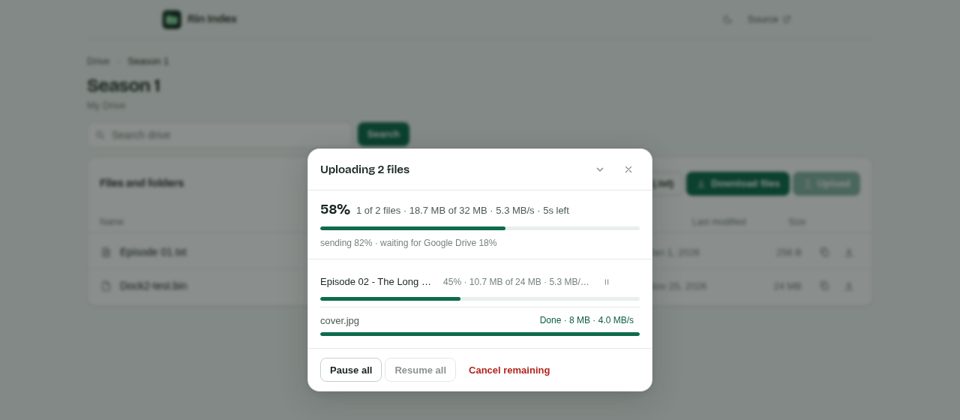

<div align="center">



**Browse, preview, and download files from your Google Drive.**

<p>
  <a href="https://github.com/Chowdhury-Siam/Google-Index/actions"></a>
  <a href="https://developers.cloudflare.com/workers/"></a>
  <a href="https://developers.google.com/workspace/drive/api/guides/api-specific-auth"></a>
</p>

[**Deploy**](#deploy) · [**Features**](#features) · [**Repository secrets**](#repository-secrets) · [**Troubleshooting**](#troubleshooting)

</div>

---

## Meet Rin Index

Rin Index gives a Drive folder, Shared Drive, or My Drive a file browser on Cloudflare Workers Free. Google Drive remains the file source. Browsing and downloading need only Google’s read-only Drive permission; uploads and file management are optional and use the full Drive scope.

## Features

| Feature | What you can do |
| --- | --- |
| **Browse** | Follow folder breadcrumbs and see each item’s type, date, and size on desktop or mobile. |
| **Sort & filter** | Order the listing by name, date, or size from the column heads or the Sort menu, and narrow the page to folders, images, video, audio, or documents with one tap. |
| **Shortcuts** | Drive the page by keyboard: / searches, arrows walk the list, Enter opens, Space selects, Delete trashes, N adds, and ? lists every key. |
| **Recent files** | The clock in the top bar lists the files this browser opened or downloaded most recently, with one click back to each. |
| **Thumbnails** | Image rows show the render Drive already made, proxied through the Worker so credentials stay server-side, and loaded only as they scroll into view. |
| **Search** | Search by name when indexing My Drive or a Shared Drive, with type: and size: filters (type:video size:>100MB) that ride the same Drive query and show as removable chips. |
| **Preview** | Open supported text, image, audio, video, and PDF files in the browser. |
| **Download** | Download a file from its row or preview page. |
| **Download files** | Start separate downloads for the files in the current folder and its subfolders. |
| **Save links (.txt)** | Save one direct file URL per line for a mirror or leech bot’s bulk mode. |
| **Copy URL** | Copy the direct download URL of any file, including files in nested folders. |
| **Admin sign-in** | Sign in once with the lock icon and stay signed in for eight hours; the password is never kept in the page. |
| **Upload** | As the admin, upload files, whole folders, or dropped items into the open folder, with a progress dialog showing speed and time remaining for every batch. |
| **Pause / resume / cancel** | Pause an upload and keep its Google Drive session, resume from the byte Drive confirmed, or cancel and close the session — per file or for the whole batch. |
| **Transfer history** | Settled batches stay in the uploads dialog with their per-file outcomes and copy-report until dismissed; the dock calls out failed files, and a retried upload replaces the failure it fixes. |
| **Manage files** | Create folders, rename, move, and delete items right from the listing — one at a time or several at once. |
| **Storage** | See how full the Google account behind the index is, from Google Drive’s own quota. |
| **Dialogs** | Every dialog — sign-in, uploads, folder creation, renaming, moving, deletion, previews — opens centered over a dimmed page, closes with Escape, and keeps keyboard focus inside itself. |
| **Theme** | One fixed dark theme in the z.ai monochrome language: a #0d0d0d page, a #161616 header bar over a left icon rail, white pill actions, flat 16px cards, never switched by the device. |
| **Folder notes** | Display `HEAD.md` above a folder’s files and `README.md` below them. |
| **Access** | Add an optional browser password and choose whether direct downloads also require it. |

### Sort, filter, and drive the page by keyboard

The listing can be ordered by name, date, or size: click a column head on a desktop (click again to reverse it) or the **Sort** button (any screen) for the full menu. Ordering is applied by Google Drive itself, so every page of a large folder lines up the same way. Above the list, chips narrow the loaded page to folders, images, video, audio, or documents — a client-side filter, so it costs no request.

Keyboard use: **/** focuses search, **↑**/**↓** move through the rows, **Enter** opens the highlighted item, **Space** selects it, **Delete** moves it to the trash, **N** opens the New menu, **Esc** closes whatever is on top, and **?** shows the list. Keys pause while you type or while a dialog is open.

The clock button in the top bar keeps the **recently opened** list — files this browser opened or downloaded, stored only in this browser's local storage — with a time note and one click back to each. Nothing about them is sent anywhere.

Search accepts filters in the field itself: `type:video`, `type:image`, `type:audio`, `type:doc`, `type:pdf`, `type:folder`, and sizes like `size:>100MB` or `size:<500KB`, combined with plain words. Active filters appear as chips under the field; click a chip's x to search again without it.

Image rows show a **thumbnail** where Drive has one. The request goes to the same path as the file itself (`?thumb=1`) and the Worker fetches Drive's render with its own credentials, so no token or session URL ever reaches the page; thumbnails carry the same access rules as a direct download, and load lazily as they scroll into view.

### Download files from a folder

Open the folder and click **Download files**. Keep the folder page open while it starts the downloads, and allow multiple downloads if prompted. Rin Index goes through every page of the folder and its subfolders. The browser controls when each transfer runs and where it saves each file.

For a mirror or leech bot, click **Save links (.txt)** to download a TXT file named after the folder. For example, **ARC 01** downloads as `ARC 01.txt`. Send the file to the bot and reply with your bot’s bulk command, such as `/leech -b` or `/mirror -b`. The list includes files in subfolders. If direct file links require sign-in, configure the bot to authenticate with Rin Index. [Mirror-Leech-Telegram-Bot bulk download support](https://github.com/anasty17/mirror-leech-telegram-bot#overall)

Supported Google Workspace files are exported individually. Other Google Drive formats and shortcuts can be saved as links to the original item. Google Drive may restrict downloading or exporting specific files. [Google Drive’s download and export limits](https://developers.google.com/workspace/drive/api/guides/manage-downloads)

### Copy a file’s direct URL

Every file row has a **Copy URL** button beside the download button. It copies the full direct-download address of that file, with the folder path encoded, so it works for files in nested folders. The copied URL points at Rin Index itself, so every access rule still applies: on a private index or with `PROTECT_FILE_LINK` enabled, opening the URL asks for the same sign-in as a normal download. On phones and desktops the button stays a large tap target, and a brief “URL copied” note confirms each copy.

### Upload files to a folder

Set the `ADMIN_PASSWORD` repository secret to turn on admin access. Visitors see only a small lock icon in the top bar; the admin signs in there once with the `ADMIN_USERNAME` and `ADMIN_PASSWORD` pair and stays signed in for eight hours — the sign-in sets an HttpOnly session cookie, so the password itself is never stored in the page, and changing the password ends every session at once. While signed in, a folder page offers a **New** button with three ways to add files: **Upload files** picks one or more files from a phone or PC, **Upload folder** picks a whole directory with its subfolders (folders are created level by level before their files are sent), and dropping files or folders anywhere on the file panel uploads them the same way.

Uploads run in one centered progress dialog, which folds into a small dock when you want the page back and keeps several batches side by side: each file shows its name, progress bar, percentage, bytes uploaded out of the total, current speed, and estimated time remaining, and each batch also gets a whole-batch progress line. Speed and time remaining are calculated from the bytes Google Drive actually confirmed, so retries never inflate them. When an upload is interrupted, the panel shows the retry, the browser asks Drive how much it received, and the same session resumes from that byte instead of creating a duplicate file. The listing refreshes after a successful batch.

Every file also has its own controls, and the batch footer has **Pause all**, **Resume all**, and **Cancel remaining**:

- **Pause** stops sending chunks immediately and keeps the Google Drive upload session. The row shows **Paused** with the byte Drive confirmed and no time estimate until it resumes. Folding the dialog into its dock keeps the upload running behind the small pill; Escape or a click on the dimmed page folds it just the same. After a batch settles it stays in the dialog as history — per-file outcomes, the report button, and a per-batch dismiss — with the last three kept; the dock names any failed files until they are retried or dismissed, and **Retry failed** moves the failed files into a fresh batch.
- **Resume** asks Drive for the byte it confirmed and continues exactly from there. If a chunk was cut off mid-transfer, only the unconfirmed part is sent again — the file is never restarted and no duplicate is created. A connection drop parks the file as **Paused** with the reason, and it resumes by itself when the browser comes back online; pressing Resume works too.
- **Cancel** stops the transfer and the automatic retries, and asks the Worker to close the unfinished Drive session (Drive answers 499 and discards the partial bytes; an abandoned session would otherwise linger for about a week). Files that already finished uploading are kept. After the batch settles, **Copy report** puts a plain-text summary on the clipboard, including how much time was spent sending bytes versus waiting for Drive to confirm them.

Every upload request is checked against the admin credentials on the server before Google Drive is contacted. Public visitors and users with only the browse password can never upload. Uploads use Google Drive’s resumable upload API in chunks that start at 16 MB and double as the transfer proves reliable, up to 95 MB — the largest multiple of Drive’s 256 KB unit below the 100 MB request-body limit of Cloudflare Free and Pro zones, so a request can never be refused with 413. The Worker streams each chunk straight through to Drive while it is still arriving from the browser and declares the chunk’s exact `Content-Length` on the upstream request, so the browser→Cloudflare and Cloudflare→Drive legs overlap instead of running back to back. In Rin Index’s emulated measurements on a 7.5 MB/s line, that pipeline plus the larger chunks reaches about 6.8–7.0 MB/s where the previous buffered release measured about 3.8 MB/s and a request of undeclared length would fall back to about 4 MB/s. The real path can differ, so the panel shows the same split live — a line like “sending 91% · waiting for Google Drive 9%” tells you whether your own connection, the pauses between chunks, or Drive’s ingest is the limit. The Worker never holds a whole file in memory, each request performs a single subrequest, and uploads create a new Drive file each time without overwriting existing files.

### Manage files and folders

While signed in as the admin, every folder page works as a small file manager. The **New** button creates a folder; each row has a three-dot menu with **Rename**, **Move to…**, and **Delete**; and the checkboxes build a selection of many items at once, with a toolbar that offers the same actions for everything selected. Actions are also available from search results — Rin Index asks Drive where the item lives before acting on it. The move dialog is a folder picker that walks the index with breadcrumbs and can create a new folder inside the destination without leaving it, and it refuses to move a folder into itself. While a create, rename, move, or delete request is in flight, its dialog keeps itself open, so a stray click or Escape cannot dismiss it halfway.

Rin Index keeps Drive’s safety rails. Deleting moves items to Google Drive’s trash, where they can be restored for 30 days, and trashed files keep counting against the storage quota. A rename or move is refused when the destination already holds an item with that name, because the index opens files by path and two items with one name could not both be reached. Large selections are sent in groups of twelve, the largest batch that stays well inside Cloudflare Workers Free subrequest limits, and a summary names anything Drive refused. Google Drive states per item what the account may do; when an item is shared read-only, its menu hides the actions Drive would refuse anyway. Every management request is checked against the admin session before Google Drive is contacted, and the read-only `drive.readonly` scope cannot manage files — reauthorize with the full `drive` scope to use this.

### Storage summary

On a folder page the admin also sees a storage card between the page head and the files: how full the account is, with used, available, total, in Drive, and in trash, exactly as Google Drive reports it. The figures refresh after each upload, delete, or move, and the card’s refresh button asks Drive for the current quota. Values Drive does not report (for example, no limit) stay blank rather than estimated; the card is never shown to visitors.

## Deploy

### 1. Connect Google Drive

1. In [Google Cloud Console](https://console.cloud.google.com/), select a project and enable the **Google Drive API**.
2. In **Google Auth Platform**, configure **Branding** and **Audience**. If your app is **External** and in **Testing**, add the Google account that can access your folder under **Audience → Test users**.
3. Go to **Clients → Create client**. Choose **Web application**, name it **Rin Index**, and leave **Authorized JavaScript origins** blank. Add this exact value under **Authorized redirect URIs**.

   ```text
   https://developers.google.com/oauthplayground
   ```

4. Click **Create** and save the client ID and client secret. Open [Google OAuth 2.0 Playground](https://developers.google.com/oauthplayground/), click the gear icon, and select **Use your own OAuth credentials**. Enter both values. Keep the flow **Server-side** and the access type **Offline**.
5. In **Step 1**, paste the scope below into **Input your own scopes**. Click **Authorize APIs**, sign in with the account that can open the folder, and grant access. Use the first scope for browsing only, or the second scope if you also enable uploads or file management.

   ```text
   https://www.googleapis.com/auth/drive.readonly
   https://www.googleapis.com/auth/drive
   ```

6. In **Step 2**, click **Exchange authorization code for tokens**. Copy the full **Refresh token** field. Store it with the matching client ID and client secret. See [Google’s OAuth Playground guide](https://developers.google.com/explorer-help/code-samples).

> [!NOTE]
> Google expires Drive refresh tokens after seven days while an **External** OAuth app is in **Testing**. If you later change the app’s publishing status, generate a fresh token and update the GitHub secret. [Google’s refresh token rules](https://developers.google.com/identity/protocols/oauth2#expiration)

### Give the account write access for uploads and file management

The `drive.readonly` scope can browse and download but not create, rename, move, or trash files. To reauthorize an existing read-only setup for admin access, repeat the Playground steps above with `https://www.googleapis.com/auth/drive` as the scope, then replace the `GOOGLE_REFRESH_TOKEN` secret with the new token. The deploy script accepts either scope and refuses to deploy admin features with a read-only token.

The full `drive` scope is the narrowest scope that works for uploading into folders that already exist. The smaller `drive.file` scope only covers files an app created itself or received through the Google Picker, so it cannot create files inside the indexed folder tree. The Google account must also have edit permission on the destination folder; a share link with viewer access is not enough. [Google Drive API scopes](https://developers.google.com/workspace/drive/api/guides/api-specific-auth)

### 2. Prepare Cloudflare

1. In **Workers & Pages**, set up your `workers.dev` subdomain and copy the **Account ID**.
2. Create a Cloudflare API token using **Edit Cloudflare Workers** and scope it to your Cloudflare account. [Cloudflare’s GitHub Actions setup](https://developers.cloudflare.com/workers/ci-cd/external-cicd/github-actions/)
3. GitHub Actions deploys to `rin-index` by default, using the `name` in `wrangler.toml`. To deploy to a different Worker, set the `CLOUDFLARE_WORKER_NAME` repository secret to that Worker's name. [Cloudflare’s workers.dev setup](https://developers.cloudflare.com/workers/configuration/routing/workers-dev/)

### 3. Add your repository secrets

Create or open the GitHub repository, then go to **Settings → Secrets and variables → Actions → Secrets**. Use **New repository secret** for each required entry below. [GitHub’s repository secret setup](https://docs.github.com/en/actions/how-tos/write-workflows/choose-what-workflows-do/use-secrets)

<a id="repository-secrets"></a>

| Required secret | Value |
| --- | --- |
| `CLOUDFLARE_ACCOUNT_ID` | Your Cloudflare account ID |
| `CLOUDFLARE_API_TOKEN` | The API token from Cloudflare |
| `GOOGLE_CLIENT_ID` | Your Web application’s OAuth client ID |
| `GOOGLE_CLIENT_SECRET` | The matching OAuth client secret |
| `GOOGLE_REFRESH_TOKEN` | The **Refresh token** from Step 2 in the OAuth Playground |
| `DRIVE_ID` | The ID of the folder or Shared Drive you want to serve at `/0:/`. Use `root` to index all of My Drive. |

For `DRIVE_ID`, copy the part of the Drive URL after `/folders/` and before the `?`. For example, `/folders/1AbC_dEf-123?usp=sharing` gives `1AbC_dEf-123`. The Google account that authorized Rin Index must have access to the folder. If you already use `DRIVE_ROOT_ID`, it still works when `DRIVE_ID` is unset.

If your mirror bot uploads to a fixed folder and sends links like `/0:/file.zip`, use that upload folder’s ID for `DRIVE_ID`. After deployment, files in that folder open directly from `/0:/`.

| Optional secret | Default | Effect |
| --- | --- | --- |
| `CLOUDFLARE_WORKER_NAME` | `name` in `wrangler.toml` | Overrides the Cloudflare Worker name for GitHub Actions deployments. |
| `SITE_NAME` | Rin Index | Labels the collection and the browser tab. |
| `INDEX_PASSWORD` | Unset | Require a password to browse the index. |
| `INDEX_USERNAME` | `viewer` | Set the username for password-protected browsing. |
| `INDEX_PUBLIC` | Automatic | The index is public with no password. Set this to `true` to allow public browsing with a password configured. |
| `PROTECT_FILE_LINK` | `false` | Set to `true` with an index password to require sign-in for direct downloads. |
| `ADMIN_PASSWORD` | Unset | Set to enable admin uploads and file management. Must be paired with a `GOOGLE_REFRESH_TOKEN` for the `drive` scope. |
| `ADMIN_USERNAME` | `admin` | Set the username for admin sign-in. |

> [!TIP]
> Direct download URLs work without a password by default. Turn on `PROTECT_FILE_LINK` if you want the index password to cover downloads as well.

### 4. Run GitHub Actions

For a **new repository**, open PowerShell in the extracted folder that contains `wrangler.toml` and run the commands below. Replace the example remote URL with your repository URL.

```powershell
git init -b main
git add --all
git commit -m "Set up Rin Index"
git remote add origin https://github.com/YOUR-USERNAME/YOUR-REPO.git
git push -u origin main
```

To **upgrade an existing repository**, copy the project contents into its working folder, including `.github/workflows/deploy.yml`. Remove the old Bootstrap and MDUI assets under `public/assets`, the old `public/assets/favicon.ico`, and the two old screenshots in `images`. If present, delete `.github/workflows/prepare-folder-zip.yml`, `scripts/prepare-folder-zip.mjs`, `worker/folder-archive.mjs`, `worker/stored-archive.mjs`, `worker/zip.mjs`, and `test/folder-archive.test.mjs`. Commit the update and push to `main`.

Open **Actions → Deploy Rin Index**. The workflow runs the tests, prepares the browser assets, checks Google Drive access, and sends the code and Worker secrets to Cloudflare. Expand **Deploy to Cloudflare** to find your `workers.dev` URL. Open it and try browsing a folder and downloading a file.

After editing a repository secret, start a fresh run with **Actions → Deploy Rin Index → Run workflow → main**.

## Troubleshooting

| What you see | What to check |
| --- | --- |
| **Set DRIVE_ID before deploying** | Add the repository secret `DRIVE_ID` and start a fresh workflow run. |
| **DRIVE_ID must be a folder ID, Shared Drive ID, or root** | Paste the ID from the folder URL, or enter `root` for My Drive. |
| **Google rejected the token refresh** | Check that the client ID, client secret, and refresh token belong to the same OAuth client. Generate a new token if it expired. |
| **Google Drive could not open DRIVE_ID** | Check the folder ID and whether the Drive API is enabled. If the folder was shared with you, ask the owner to share it directly with the Google account that authorized Rin Index. |
| **Cloudflare rejects the deployment** | Check the account ID, token permissions, and `workers.dev` subdomain setup. |
| **Search is missing** | Search is available for My Drive and Shared Drive roots. Use breadcrumbs to browse a selected subfolder. |
| **Uploads are not configured** | Add the `ADMIN_PASSWORD` repository secret and start a fresh workflow run. |
| **Uploads need the full Drive scope** | Reauthorize through the OAuth Playground with `https://www.googleapis.com/auth/drive` and update `GOOGLE_REFRESH_TOKEN`, or remove `ADMIN_PASSWORD`. |
| **“This Google sign-in behind this index has read-only access”** | Management needs the full `drive` scope. Reauthorize with the Playground and replace `GOOGLE_REFRESH_TOKEN`, or keep admin features off. |
| **“An item named … already exists here”** | Rin Index opens files by path, so two items cannot share one name in a folder. Pick a different name. |
| **This Google account cannot create files in that folder** | The authorizing account needs edit permission on the destination folder. Ask the owner for editor access. |
| **Admin sign-in failed** | Check the `ADMIN_USERNAME` and `ADMIN_PASSWORD` secrets, and sign in through the lock icon in the top bar. On a private index, signing in to browse with the admin pair also unlocks the admin features. |
| **This upload session expired** | Drive sessions last about a week. Start the upload again; a fresh upload creates a new file rather than overwriting. |
| **An upload is “Paused” with “connection kept failing”** | The line dropped mid-transfer. The file is kept with its Drive session; press **Resume** once you are back online, or just reconnect and it resumes by itself. |
| **“Cancelled” but the note says Drive could not confirm the session was closed** | The cancel still stopped the transfer. Google expires an abandoned session on its own after about a week. |
| **Uploads run slower than my line** | Open the panel’s “sending / waiting” line: a large waiting share means the time goes to Drive’s confirmations between chunks, not to your connection. Larger chunks (already automatic) and parallel files reduce it; a waiting share near half with a small sending share points at the Cloudflare→Drive leg itself. |

## Credits

Rin Index’s interface and documentation take their visual cues from [Yutaka](https://github.com/Chowdhury-Siam/Yutaka); the current layout follows the flat, monochrome chat.z.ai design language — a left icon rail, a rounded header bar, pill actions, and grey-on-grey surfaces — rebuilt with a hand-drawn stroke icon set and the site’s own mark (drawn as a light glyph in the rail). The Bricolage Grotesque type files remain bundled ([SIL OFL](public/assets/fonts/OFL.txt)) though the interface now uses the system sans stack. The Drive Worker builds on [Bhadoo Drive Index](https://github.com/ParveenBhadooOfficial/Bhadoo-Drive-Index) by Parveen Bhadoo and TheFirstSpeedster, with earlier work from [GDIndex](https://github.com/maple3142/GDIndex) and [goindex](https://github.com/yanzai/goindex).

